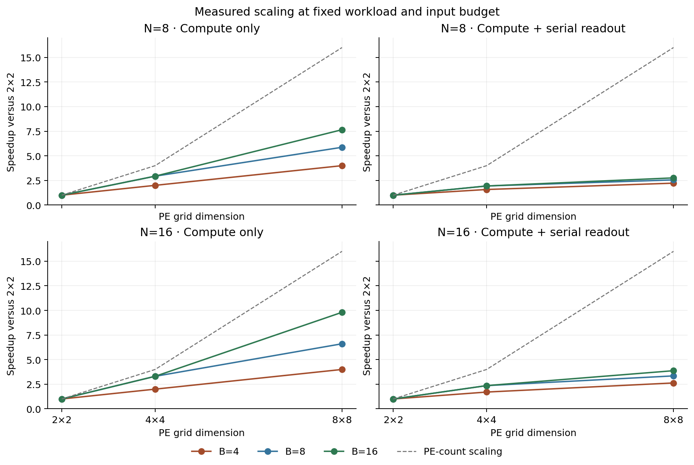

# Systolic Array Scaling

[](https://github.com/OzPol/systolic-array-scaling/actions/workflows/ci.yml)

A parameterized **output-stationary matrix multiplier in VHDL**, built to study how PE-grid size, operand supply, and finite workloads affect accelerator performance and FPGA cost.

The project compares **2×2, 4×4, and 8×8 processing-element grids** on the same complete **8×8 and 16×16 matrix products**, with input budgets of **4, 8, and 16 combined A/B words per clock**. These choices form eighteen simulation configurations. The 2×2 grid is the performance reference.

The architecture question is whether adding arithmetic units produces proportional gains when input delivery and result handling also consume time. The experiment measures compute latency, stalls, useful MAC throughput, PE utilization, complete-product speedup, FPGA resources, and internal timing.

## Architecture

Each PE multiplies signed 16-bit operands and accumulates a 36-bit result. A values move right, B values move down, and partial sums stay in the PE. The input stager aligns operands and holds the grid while a boundary step is incomplete.

The controller partitions C into P×P output tiles. Every tile streams the full inner dimension N, captures its P² results, and clears the grid before the next tile. After all tiles finish, the result store serializes N² output words.

| PE grid | MAC units | Peak boundary demand | Output tiles, N=8 | Output tiles, N=16 |
|---|---:|---:|---:|---:|
| 2×2 | 4 | 4 words/clock | 16 | 64 |
| 4×4 | 16 | 8 words/clock | 4 | 16 |
| 8×8 | 64 | 16 words/clock | 1 | 4 |

The input budget controls the implemented RTL boundary interface. The FPGA flow targets the K26 device used by KV260. A board is unnecessary for simulation, analysis, or out-of-context implementation.

## Tools and workflow

| Tool | Purpose |
|---|---|
| VHDL-2008 | PE grid, input staging, tiled controller, result storage/readout |
| GHDL or QuestaSim | Execute the self-checking RTL testbenches and record cycles and activity |
| Python | Generate/reference-check vectors, validate measurements, and build tables and figures |
| Vivado | Synthesize, place, and route the RTL; report FPGA resources and internal timing |
| Offline HTML replay | Inspect recorded MAC events, stalls, and tile transitions |

## Quick start: Windows with WSL2

Use an existing Ubuntu installation if you have one. Otherwise, run this once in **PowerShell as Administrator**, then complete Ubuntu's first-start setup:

```powershell
wsl --install -d Ubuntu-24.04
```

Open the **Ubuntu terminal**. Run the following there, keeping the checkout in the Linux home filesystem:

```bash
sudo apt-get update
sudo apt-get install -y git

git clone https://github.com/OzPol/systolic-array-scaling.git
cd systolic-array-scaling

bash scripts/bootstrap.sh --install-system
source .venv/bin/activate
make check
```

The clone uses the repository's default branch. The Python analysis environment requires **Python 3.12+**. Ubuntu 24.04 supplies it; an existing Ubuntu 22.04 installation can use the managed-interpreter instructions in [tool setup](docs/setup.md).

A successful check includes three component-test PASS markers, eighteen configuration PASS lines with eight cases each, `PASS: 144 cases`, and the printed verification-output directory. A failed check stops the workflow with a nonzero exit status.

### Linux and macOS

On Ubuntu 24.04 or Debian with Python 3.12+, use the clone and bootstrap steps above. After the system packages exist, `bash scripts/bootstrap.sh` creates the environment without installing system tools again.

On macOS with Homebrew, install the tools and create the environment from the repository root:

```bash
brew install ghdl python@3.12 make
python3.12 -m venv .venv
source .venv/bin/activate
python -m pip install -r requirements.txt
make check PYTHON=python
```

Linux/GHDL is the verified workflow. The macOS commands provide the equivalent native setup. For editor integration, see [VS Code](docs/vscode.md).

### Container alternative

From the repository root, with Docker installed:

```bash
docker build -t systolic-study .
docker run --rm systolic-study
```

To retain generated outputs on the host:

```bash
mkdir -p results/raw
docker run --rm -v "$PWD/results/raw:/app/results/raw" systolic-study
```

The container runs `make check` with Ubuntu 24.04, GHDL, Python, and the pinned dependencies. Vivado runs separately in an environment with its installation and device support.

## Run the project

Run commands from the repository root. The Makefile selects `.venv/bin/python` when that environment exists.

| Task | Command | Result |
|---|---|---|
| Analyze the saved study | `make analysis` | New validated tables, plots, and offline replay |
| Measure a complete new study | `make study` | All eighteen simulation configurations and six sequential P/N FPGA builds, followed by analysis |
| Open-source verification | `make check` | Vector checks, Python tests, RTL regressions, complete GHDL sweep, analysis, and replay |
| Python validation tests | `make unit` | Measurement and pipeline regression checks |
| Directed RTL regressions | `make rtl` | PE, input-stager, and synthesis-mode checks |
| Simulation sweep only | `make sweep` | All eighteen configurations and per-case measurements |
| Check the fixed vectors | `make vectors` | Verify committed vectors and checksums |
| Rebuild published documents | `make publish` | Refresh the saved-study analysis and document outputs |

Measurement and analysis commands create unique UTC-timestamped directories under `results/raw/`. They print the destination, record source identity and tool versions, and preserve earlier runs. `make study` checks dependencies before starting its long builds and executes the FPGA configurations one at a time.

For a targeted simulation or deliberate vector regeneration:

```bash
python scripts/sim.py --sim ghdl --p 8 --n 16 --b 4
python scripts/gen_vectors.py --help
```

### QuestaSim

With the licensed `vlib`, `vcom`, and `vsim` executables on PATH:

```bash
python scripts/test_rtl.py --sim questa
python scripts/sim.py --sim questa --sweep
```

The runner uses the same vectors, numerical reference, coverage checks, and measurement format. Licensing and compile-order details are in the setup guide.

### Vivado

Activate your installed Vivado environment before FPGA implementation. For the installation path used by the Ubuntu setup:

```bash
source "$HOME/AMDDesignTools/2025.2.1/Vivado/settings64.sh"
vivado -version
```

Use `make study` for the complete experiment. The hardware-only runner is also available:

```bash
python scripts/vivado/run.py
```

Its default covers all P=2,4,8 and N=8,16 pairs in one automatically named destination. `--p 4 --n 8` narrows a debugging run; `--resume` accepts completed builds only when their recorded source matches. The flow uses `xck26-sfvc784-2LV-c`, a 10 ns constraint, `INSTR=false`, and out-of-context synthesis, optimization, placement, and routing. See the setup guide for installation and report inspection.

## Watch the simulation

Open the [offline replay](results/visualization/replay.html) from a local checkout. Choose a configuration, play or scrub physical clocks, and switch between these views:

- **PE topology:** the grid connections, active MACs, and completed work within each tile.
- **3D work surface:** completed useful MACs over PE row and column.
- **3D space–time:** recorded MAC events over row, column, and physical time, exposing input-wait gaps.

The 3D views rotate by dragging. No server or frontend installation is required. GitHub displays the source HTML; download or clone the repository to run the replay.

### Activity across all grid and input-budget configurations


The sheets cover both complete matrix workloads and all eighteen configurations. The animation compares progress on a shared physical clock. Trace validation checks MAC totals, holds, tile completion, and readout before generating these views.

`make analysis` rebuilds the replay and activity figures from the saved traces into a new output directory. `make study` records fresh traces as part of its full experiment. [Visualization details](docs/visualization.md) explain the geometry, waveforms, and routed-checkpoint inspection.

## Measured findings

The saved study contains **144 passing simulation cases** and **three N=16 post-route FPGA implementations**. At N=16 and B=16, the 8×8 grid provides **9.806× compute speedup** over 2×2 and **3.874× complete-product speedup** after serial readout. All three FPGA builds meet the constrained internal 10 ns target. The largest grid minimizes latency; the smallest delivers the most useful work per DSP.




The [generated analysis](results/analysis/report.md) contains the configuration tables and interpretations, including utilization, stalls, scaling efficiency, and timing-qualified throughput. Original simulation measurements, routed reports, and logs remain the numerical sources. The timing result covers constrained internal FPGA paths; board I/O, physical DRAM rates, CPU comparisons, and energy are outside this experiment.

## CI and artifacts

[CI](.github/workflows/ci.yml) runs the open-source verification and Chromium replay checks for pull requests, configured branch pushes, and manual dispatch. Action revisions are pinned and repository permissions are read-only. Vivado implementation uses the separately installed hardware toolchain.

Download generated CSVs, provenance, logs, tables, figures, and replay files through **Actions → CI → run → Artifacts**. The workflow retains outputs for thirty days and uploads diagnostic artifacts on failure.

## Repository map

| Path | Purpose |
|---|---|
| [rtl/](rtl/) | Types, PE, grid, input staging, tiled controller, and readout |
| [tb/](tb/) | Fixed vectors, complete-product testbench, directed RTL regressions |
| [analysis/](analysis/) | Independent cycle model, measurement validation, metrics, plots, and replay |
| [tests/](tests/) | Python regression tests |
| [scripts/](scripts/) | Setup, simulation, experiment orchestration, report collection, document builds |
| [constraints/](constraints/) | Shared 10 ns clock constraint |
| [results/](results/) | Saved measurements, verification records, FPGA reports, generated figures |
| [docs/configurations.csv](docs/configurations.csv) | The eighteen architectural parameter combinations |
| [docs/documentation.md](docs/documentation.md) | Walkthrough of the matrix operation and project rationale |
| [docs/architecture.md](docs/architecture.md) | Interfaces, arithmetic, timing conventions, and controller behavior |
| [docs/experiments.md](docs/experiments.md) | Workloads, metric definitions, and comparison rules |
| [docs/setup.md](docs/setup.md) | Installation, tool configuration, and troubleshooting |
| [docs/review.md](docs/review.md) | Chronological development history and verification records |
| [CONTRIBUTING.md](CONTRIBUTING.md) | Change scope, validation, and measurement integrity |

## Project documents

- IEEE report: [PDF](deliverables/report/final-report.pdf) and [editable source](deliverables/report/final-report.tex).
- Presentations: [all three editable editions](docs/presentations/) and the [technical Markdown deck](docs/presentations/systolic-array-scaling-technical.md).
- Five-minute speaking material: [narration](deliverables/presentation/narration.md), covering the first thirteen slides of the expanded editions.
- Submitted proposal: [PDF](docs/eel5764_systolic_array_project_proposal.pdf) and [Markdown](deliverables/proposal/Proposal.md).
- Original video storyboard: [outline](deliverables/video/outline.md).
- Course requirements: [guidelines PDF](docs/eel5764_project_guidelines_fall_2026.pdf).
- Artifact locations: [project artifact index](docs/completion.md).

## Team

Ozlem Polat · Thomas Martin · Keith Kamer

EEL5764 Computer Architecture · University of Florida · Fall 2026
