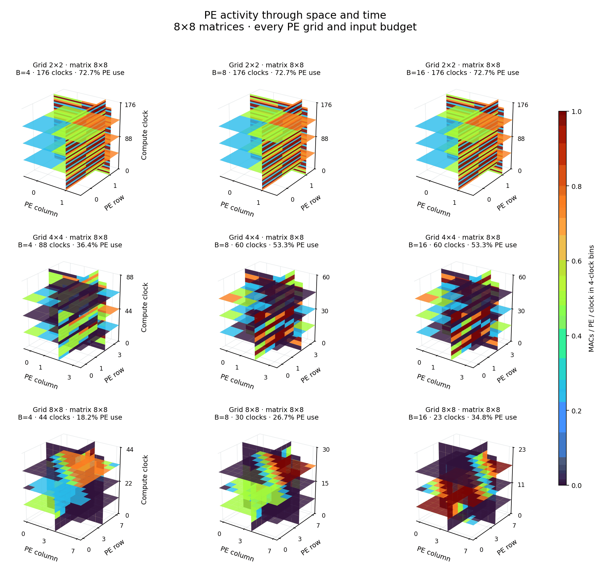
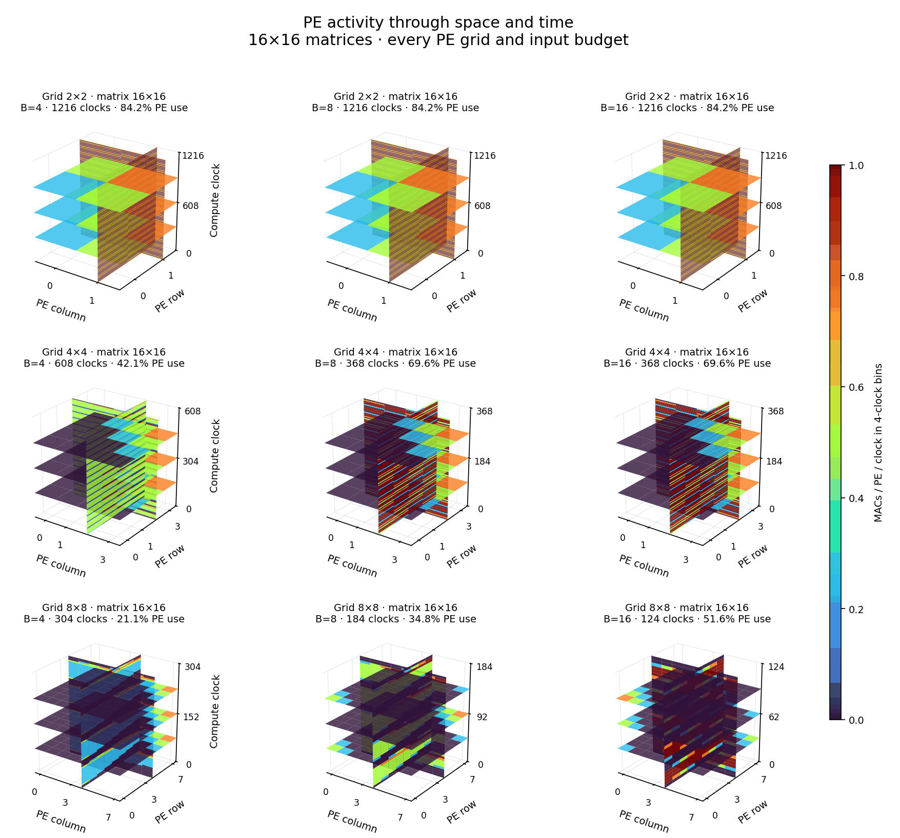
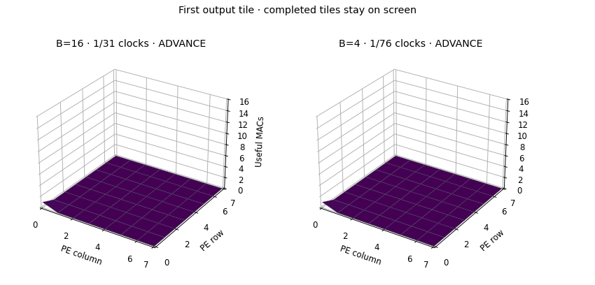

# Systolic Array Scaling

[](https://github.com/OzPol/systolic-array-scaling/actions/workflows/ci.yml)

A parameterized VHDL matrix multiplier for EEL5764, University of Florida. We compare **2×2, 4×4, and 8×8 PE grids**, full **8×8 and 16×16 matrix products**, and modeled input budgets of **4, 8, and 16 combined words per clock**: 18 configurations.

The question is how input supply, finite workloads, and tile overhead limit the benefit of adding arithmetic units. The input budget is an RTL model; it is not measured KV260 DRAM bandwidth.

## Current evidence

- Thomas Martin's implementation and original results were merged separately in [PR #1](https://github.com/OzPol/systolic-array-scaling/pull/1). His original commits and authorship are preserved.
- The original Questa sweep records **144 passing cases**. An independent GHDL sweep also passes all 144, with full 36-bit output comparison and independent interface-clock checks.
- Directed RTL regressions cover the PE, input stager, and agreement between instrumented and synthesis-mode datapaths. Python tests reject incomplete, duplicate, failed, and inconsistent measurements.
- Thomas's remaining Vivado results were merged in [PR #3](https://github.com/OzPol/systolic-array-scaling/pull/3). **All three grids meet the constrained internal 10 ns target**; all simulation and FPGA runs for the planned study are complete.

| PE grid | LUTs | Flip-flops | DSPs | BRAM tiles | Internal WNS |
|---|---:|---:|---:|---:|---:|
| 2×2 | 7,260 | 9,437 | 4 | 0 | +3.955 ns |
| 4×4 | 11,488 | 9,505 | 16 | 0 | +3.786 ns |
| 8×8 | 8,166 | 10,211 | 64 | 0 | +2.176 ns |

These are post-route N=16 reports from Vivado 2025.2.1 on the same K26 part with `INSTR=false`. External I/O delays are unspecified; this is internal timing evidence, not a board measurement.

At N=16/B=16, compute cycles are 1216 / 368 / 124. At N=16/P=8/B=4, 180 budget stalls increase compute latency to 304 clocks. Larger arrays still help in every tested case; the measurements show reduced scaling efficiency rather than a complete loss of scaling benefit.

Start with the [analysis](results/analysis/report.md), [contribution review](docs/review.md), and [submission checklist](docs/completion.md).

## Project documents

- [Final report PDF](deliverables/report/main.pdf) and [editable LaTeX source](deliverables/report/main.tex).
- [Submitted project proposal PDF](docs/eel5764_systolic_array_project_proposal.pdf).
- [Course project guidelines PDF](docs/eel5764_project_guidelines_fall_2026.pdf).
- [Architecture and mathematical definitions](docs/architecture.md).
- [Video storyboard and narration](deliverables/video/outline.md).

PDF links open GitHub's document viewer, which also offers a download button. The HTML replay must be downloaded or opened from a local checkout to run.

## Quick start: Windows with WSL2

Run this once in **PowerShell as Administrator** if Ubuntu is not installed:

```powershell
wsl --install -d Ubuntu-24.04
```

Restart if Windows requests it. Open **Ubuntu** from the Start menu and finish creating its Linux username/password. All subsequent commands run in that Ubuntu terminal. Keep the checkout in the Linux home directory for faster simulator file access.

```bash
sudo apt-get update
sudo apt-get install -y git
```

```bash
git clone https://github.com/OzPol/systolic-array-scaling.git
cd systolic-array-scaling
```

```bash
bash scripts/bootstrap.sh --install-system
```

```bash
source .venv/bin/activate
```

```bash
make check
```

Expected final output includes three `PASS: tb_...` component tests, 18 `TB PASS ... cases=8` lines, `PASS: 144 cases`, and `Validated 18 configurations`. Any failed check returns a nonzero exit status and stops the workflow.

The completed implementation and measured FPGA evidence are on `main`.

## Linux and macOS

On **Ubuntu 24.04 / Debian with Python 3.12+**, use the same clone, bootstrap, activation, and check commands above. The `--install-system` option installs GHDL, Python/venv, make, and git through apt; sudo may request your password. After those packages exist, `bash scripts/bootstrap.sh` only creates the Python environment and installs pinned plotting dependencies.

On macOS with Homebrew:

```bash
brew install ghdl python@3.12 make
```

Create the environment with Python 3.12, activate it, and install dependencies:

```bash
python3.12 -m venv .venv
source .venv/bin/activate
python -m pip install -r requirements.txt
make check PYTHON=python
```

The tested setup is Linux with GHDL and Python 3.12. macOS is an alternative setup. The open-source workflow runs without an FPGA board or paid simulator.

## Container alternative

With Docker installed, from the repository root:

```bash
docker build -t systolic-study .
docker run --rm systolic-study
```

To retain results on the host:

```bash
mkdir -p results/raw
docker run --rm -v "$PWD/results/raw:/app/results/raw" systolic-study
```

The image runs `make check` using Ubuntu 24.04, GHDL, Python, and pinned Python packages. The Docker configuration is ready for a local build.

## Run individual steps

Activate `.venv` before running these commands. Run them from the repository root.

| Task | Command | Output |
|---|---|---|
| Verify committed vectors and checksums | `python scripts/gen_vectors.py --check` | Read-only reproducibility check |
| Regenerate vectors intentionally | `python scripts/gen_vectors.py` | `tb/vectors/` |
| Python validation tests | `python -m unittest discover -s tests -v` | Test results in terminal |
| Directed RTL tests | `python scripts/test_rtl.py --sim ghdl` | `build/ghdl_units/*.txt` |
| One matrix configuration | `python scripts/sim.py --sim ghdl --p 8 --n 16 --b 4` | Eight cases and provenance under `results/raw/` |
| All configurations | `python scripts/sim.py --sim ghdl --sweep` | `results/raw/ghdl_sim_results.csv` and `.json` |
| Analyze new measurements | `python -m analysis.report --simulation results/raw/ghdl_sim_results.csv --output results/raw/analysis` | Validated metrics, report, PNG/SVG plots |
| Reproduce plots from reviewed summaries | `python -m analysis.report` | `results/analysis/` |
| Complete open-source workflow | `make check` | All of the checks above and new analysis |

The CLI rewrites the selected run CSV for each invocation; use `--output results/raw/my_run.csv` to retain a separate run. The JSON sidecar records tool version, commit, dirty state, source/vector hashes, and CSV hash. Generated work directories are ignored by git; deliberately reviewed evidence is committed separately.

### Questa instead of GHDL

Install/licence Questa and put `vlib`, `vcom`, and `vsim` on PATH. Then:

```bash
python scripts/test_rtl.py --sim questa
python scripts/sim.py --sim questa --sweep
python -m analysis.report --simulation results/raw/questa_sim_results.csv --output results/raw/questa_analysis
```

The shell wrappers in `scripts/questa/` call this runner. The original run used QuestaSim 2026.2. Use the updated commands in the team’s licensed environment. [Tool setup and troubleshooting](docs/setup.md) covers PATH, versions, environment variables, and expected outputs.

### Vivado: reproduce the completed FPGA runs

The reviewed reports for P=2,4,8 are already committed under [results/vivado/](results/vivado/); Vivado is only needed to repeat implementation. To refresh plots from the committed evidence, run:

```bash
python -m analysis.report --simulation results/verification/ghdl_sim_results.csv
```

For an optional rerun, open a Vivado-configured command shell or source the installed Linux `settings64.sh`. From the repo root, choose a fresh destination:

```bash
python scripts/vivado/run.py --p 2 4 8 --n 16 --output-root results/raw/current_rtl
python scripts/collect_vivado.py --source results/raw/current_rtl
python -m analysis.report
```

The runner executes one configuration at a time using `xck26-sfvc784-2LV-c`, a 10 ns clock, `INSTR=false`, and out-of-context synth/opt/place/route. Do not launch parallel copies. `--resume` skips completed runs only when source hashes match. Incomplete/mismatched existing directories require a fresh `--output-root`; the runner does not delete old evidence. Vivado and its license/device support must be installed separately. See [tool setup](docs/setup.md) for report checks.

## Watch the simulation

The [offline replay](results/visualization/replay.html) lets you select a configuration, play or scrub individual clocks, and switch between three views:

- **PE topology:** the real grid connections and active MACs, with each cell showing completed work for its tile.
- **3D work surface:** PE row and column on the base; completed useful MACs on the vertical axis.
- **3D space–time:** each point is a recorded MAC event; time runs vertically, making input-wait gaps visible.

Open `results/visualization/replay.html` in your browser after cloning. It works offline. The 3D views rotate by dragging.







To regenerate everything from a fresh simulation:

```bash
python scripts/sim.py --sim ghdl --sweep --trace-dir results/raw/traces
python -m analysis.replay --trace-dir results/raw/traces --output results/raw/visualization
```

`make check` also builds these visualizations. The replay uses the fixed-seed performance case (case 5) from each configuration. Trace validation checks every MAC event, tile completion, and stall before generating the views.

The overview displays all 18 configurations. Volume slices show PE activity over physical time; work-surface height shows progress through the complete product; the wavefront surfaces mark each PE’s first and last MAC. The scaling surface joins the nine measured P/B configurations for each matrix size.

Questa and Vivado also provide their own waveform and design-inspection GUIs. See [visualization notes](docs/visualization.md) for those views and the story behind the generated figures.

## CI, artifacts, and future PRs

[`.github/workflows/ci.yml`](.github/workflows/ci.yml) runs automatically for **every pull request**, pushes to `main` and `oz-*` branches, and manual workflow dispatch. It installs GHDL and Python 3.12, installs the pinned requirements, and runs `make check` plus browser checks for the replay. GitHub Actions uses read-only repository permissions; action revisions are pinned to commit hashes.

Open **Actions → CI → a run → Artifacts** to download the measured CSV, provenance JSON, simulator logs, report, plots, and offline replay. Artifacts remain available for 30 days. Failure logs are uploaded even when a check fails. Generated reports are the build deliverable; there is no web deployment or FPGA programming step.

After the first successful run, an administrator can make **`VHDL and analysis`** a required check in **Settings → Rules → Rulesets → main** (or branch protection). Enable “Require a pull request before merging” and require that check if you want merges blocked on failures. The workflow does not change repository rules automatically.

Vivado is intentionally separate from hosted PR CI. GitHub-hosted runners do not have the team's licensed tool installation. A future licensed self-hosted runner can call the same documented Vivado command; keep that a manually controlled trusted workflow.

## Repository map

| Path | Purpose |
|---|---|
| [rtl/](rtl/) | Types, PE, array, input staging, tiled controller/readout |
| [tb/](tb/) | Full-matrix testbench, directed RTL regressions, fixed vectors |
| [analysis/](analysis/) | Separate cycle model, strict measurement validation, figures |
| [tests/](tests/) | Python tests for measurement integrity and report parsing |
| [scripts/](scripts/) | Setup, simulation, report collection, Vivado runs |
| [constraints/](constraints/) | Shared 10 ns clock constraint |
| [results/](results/) | Reviewed measurements, provenance, reports, plots |
| [docs/architecture.md](docs/architecture.md) | Clock conventions, interfaces, arithmetic, FSM, measurement definitions |
| [docs/experiments.md](docs/experiments.md) | Workloads, metrics, comparison rules |
| [docs/configurations.csv](docs/configurations.csv) | The 18 architectural configurations |
| [docs/setup.md](docs/setup.md) | Tool-specific setup and troubleshooting |
| [docs/review.md](docs/review.md) | Contribution assessment and technical findings |
| [docs/completion.md](docs/completion.md) | Completed experiment evidence and remaining submission tasks |
| [deliverables/](deliverables/) | Proposal navigation, report PDF/source, video outline |
| [CONTRIBUTING.md](CONTRIBUTING.md) | Branches, commit scope, tests, evidence requirements |

## Team

Ozlem Polat · Thomas Martin · Keith Kamer

EEL5764 Computer Architecture · University of Florida · Fall 2026
