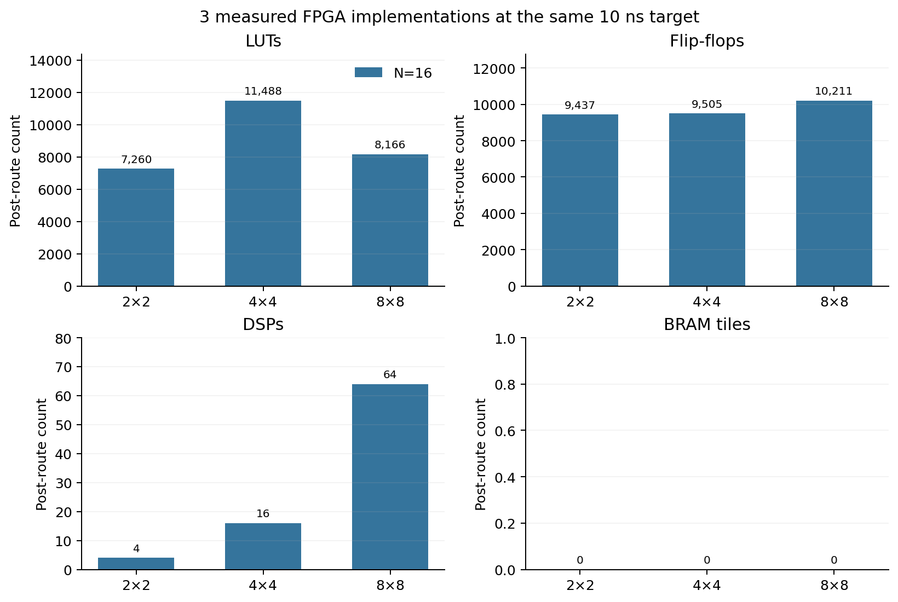

# Systolic Array Scaling

A parameterized output-stationary matrix multiplier in VHDL. The study compares **2×2, 4×4, and 8×8 PE grids**, complete matrix orders **8 and 16**, and combined input budgets **4, 8, and 16 words per clock**. The budget is an RTL operand-supply model.

[Report](deliverables/report/main.pdf) · [Presentation](deliverables/presentation/slides.pdf) · [Comparison table](results/analysis/comparison_table.md) · [Architecture](docs/architecture.md) · [Development history](docs/review.md)

## Results

The simulation comparison contains **18 configurations and 144 passing cases**. The FPGA comparison uses the **three N=16 Vivado implementations** saved in [results/vivado](results/vivado/), with their original [summary](results/summary_vivado.csv) and [console logs](results/logs/).

At full supply and N=16, compute latency is **1216 / 368 / 124 clocks** for the three grids. The 8×8 provides **9.806× compute speedup**, reduced to **3.874× through serial readout**. The 2×2 delivers the highest useful throughput per DSP. All three FPGA builds meet the constrained internal 10 ns target.




The [generated analysis](results/analysis/report.md) includes every configuration, utilization, cycle accounting, end-to-end speedup, scaling efficiency, and timing-qualified throughput. Hardware rates describe the implemented N=16 workload. External I/O timing and physical DRAM performance are outside the experiment.

## Analyze the saved study

After the one-time [Python setup](docs/setup.md), run:

```bash
make analysis
```

The command creates a new timestamped directory, validates the saved measurements, and generates tables, plots, and an offline activity replay. It requires neither Vivado nor GHDL. [VS Code instructions](docs/vscode.md) describe local exploration.

## Measure a new experiment

With the analysis environment, GHDL, and Vivado installed:

```bash
make study
```

The code generates the timestamped output folder automatically, checks vectors and RTL components, runs all 18 simulation configurations, and builds all six grid/matrix pairs sequentially. It then validates the new evidence and generates its analysis and replay. No output suffix, run ID, or matrix-size argument is needed. The default Ubuntu installation at `~/AMDDesignTools/2025.2.1/Vivado` is activated automatically when Vivado is absent from PATH.

Measurement sources must have a clean recorded commit. Tool and plotting dependencies are checked before the long builds start. New runs stay in `results/raw/`; they do not replace the paper's saved measurements.

Individual debugging builds remain available through `python scripts/vivado/run.py`. Its default also covers all six grid/matrix pairs in a unique output folder. `--p` and `--n` narrow a debugging sweep; `--resume` requires matching completed source records.

## Rebuild the report and slides

```bash
make publish
```

This regenerates the published analysis from the committed study and compiles both PDFs in a temporary directory before replacing the generated deliverables. It requires Tectonic or a complete pdfLaTeX distribution. The original measurement CSVs, reports, logs, and activity replay remain intact. No Make target commits or pushes to GitHub.

## Verification

```bash
make check
```

Checks include vector integrity, Python validation, directed RTL regressions, a fresh complete GHDL sweep, trace validation, and generated analysis. CI additionally checks replay controls and layout in a browser. The Python tests explicitly assert metrics for every grid/matrix/budget combination and exercise missing, duplicate, failed, and modified records throughout the sweep.

## Documents and evidence

| Artifact | Location |
|---|---|
| Simulation measurements | [Original summary](results/summary_sim.csv) |
| Independent simulation checks | [Verification archive](results/verification/) |
| FPGA measurements | [Reports](results/vivado/) and [console logs](results/logs/) |
| Tables and figures | [Analysis](results/analysis/report.md) |
| Recorded activity | [Replay](results/visualization/replay.html) and [visualization notes](docs/visualization.md) |
| IEEE paper | [PDF](deliverables/report/main.pdf) and [LaTeX source](deliverables/report/main.tex) |
| Five-minute presentation | [Slides](deliverables/presentation/slides.pdf) and [speaking outline](deliverables/presentation/narration.md) |
| Submitted proposal | [PDF](docs/eel5764_systolic_array_project_proposal.pdf) |
| Original video outline | [Retained outline](deliverables/video/outline.md) |
| Project artifacts | [Completion record](docs/completion.md) |

See [evidence handling](docs/evidence.md) for the measurement boundary and storage policy. Bulky local implementation checkpoints belong in separate archives rather than repeated Git revisions.
