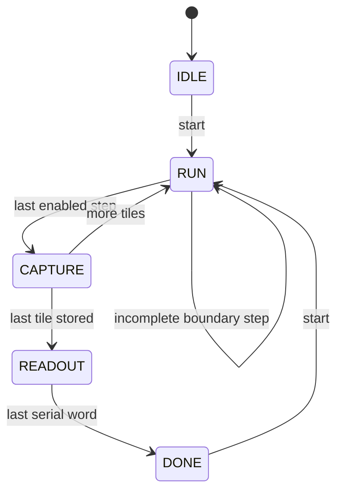

# Architecture

## Purpose and scope

This document describes the implemented output-stationary VHDL matrix multiplier. The same design generates square PE grids of size $P=2,4,8$ and computes complete $N\times N$ products for $N=8,16$. All configurations use signed 16-bit input words. The RTL includes input staging, a tiled computation controller, and serial result readout. The KV260 is a Vivado synthesis target; no physical board or external DRAM controller is in scope.

## Dataflow

The complete product is defined for zero-based matrix indices:

$$
C[i,j] = \sum_{k=0}^{N-1} A[i,k]B[k,j], \qquad 0 \le i,j < N.
$$

Here $A[i,k]$ and $B[k,j]$ are matrix entries. Elsewhere, the standalone parameter $B$ denotes the combined input-word budget; it does not change the matrix definition.

The RTL signals `tile_row` and `tile_col` are tile indices. For tile indices $(u,v)$, the global matrix origin is $(r_0,c_0)=(uP,vP)$. PE $(r,c)$ accumulates $C[r_0+r,c_0+c]$ for $0\le r,c<P$. Values from $A$ enter at the left and move right; values from matrix $B$ enter at the top and move down. Matching operands carry the same inner index $k$:

$$
C[r_0+r,c_0+c]=\sum_{k=0}^{N-1}A[r_0+r,k]B[k,c_0+c].
$$

The implemented skew schedule introduces $A[r_0+r,k]$ and $B[k,c_0+c]$ on enabled boundary steps $t=k+r$ and $t=k+c$, respectively. Both operands reach PE $(r,c)$ on enabled step $k+r+c$. The logical step $t$ advances only when staging is complete; it is not the elapsed physical clock count during stalls. Valid signals accompany operands so fill and drain cycles do not create spurious MACs. Operands presented during RUN are consumed at the rising edge when the stager is complete. Registered links move one PE per enabled rising edge; all grid registers hold on an incomplete step.

## Numeric representation

| Item | Implemented definition |
|---|---|
| Inputs | Signed 16-bit two's-complement $A$ and $B$ |
| Product | Signed 32-bit result before extension |
| PE accumulator and stored output | Signed 36-bit value |
| Maximum inner dimension | 16 terms per output |

Thirty-six signed bits preserve the exact sum for every 16-term dot product of signed 16-bit operands, including $(-32768)\times(-32768)$ repeated 16 times. The testbench compares full-width results without truncation.

## Logical modules

| Module | Responsibility |
|---|---|
| `pe` | Register and forward valid $A/B$ values; perform one useful signed MAC when a matching pair is valid; clear the accumulator at a tile boundary; hold all state on a grid stall. |
| `systolic_array` | Generate a $P\times P$ grid from the same PE; distribute boundary operands and propagate valid/stall control. |
| `input_stager` | Collect all valid words for the next boundary step subject to the selected budget; deliver one complete step to the grid without dropping or duplicating words. |
| `tile_controller` | Enumerate output tiles and inner indices, clear at the correct boundary, wait for in-flight work to finish, and store each completed tile at its global output coordinates. |
| Result storage/readout | Retain the complete $N\times N$ output and expose its elements serially after computation. Readout time is counted separately. |

The tile controller, result store, serial readout, and optional instrumentation are implemented together in `rtl/systolic_top.vhd`; the other modules have matching RTL files. Shared widths and array types live in `rtl/sys_pkg.vhd`.

## Tiling

The controller visits tiles in row-major order. Each tile streams the **full inner dimension $N$** and completes $P^2N$ useful MACs before its outputs are stored. There is no cross-tile partial-sum reuse. The number of output tiles is $(N/P)^2$: 16/4/1 tiles for $N=8$, and 64/16/4 tiles for $N=16$, at $P=2/4/8$ respectively. All sizes are divisible by each chosen $P$, so edge padding is unnecessary.

The next tile must not clear PE state until the preceding tile's last MAC has completed and its results have been captured. Serial readout occurs after the complete product is available; tile capture and transition remain part of compute latency.

## Input budget and stalls

The experiment selects a budget $B\in\{4,8,16\}$ **combined $A/B$ words per clock**. A full boundary step can request at most $2P$ words, although fill and drain steps can request fewer. The stager accumulates that step's valid words; the grid advances exactly once when the step is complete. While staging is incomplete, every PE's accumulator, forwarded data, and valid state hold. During a drain step with no new boundary words, the grid advances normally.

The implemented interface uses a runtime budget setting in synthesizable staging logic, with the same maximum-width input interface for all three budget settings. The testbench supplies operands and also checks that the RTL enforces $B$ and holds state correctly. The reported hardware comparison uses **three N=16 implementations**. The automated complete-study command builds all six grid/matrix pairs for new experiments; $B$ remains a runtime setting. The input budget is a modeled interface limit, not a measured KV260 memory rate.

At full supply ($B\ge 2P$), the stager completes the incoming step on the same clock. It adds no extra staging clock.

## Synthesis boundary

Vivado synthesized and routed all three grids, including their controller, staging logic, result storage, and serial output path, at the same 10 ns constraint and exact KV260 target part. The testbench and software reference model are excluded. The top is `systolic_top`, with `P`, `N`, and `INSTR` generics; the recorded part is `xck26-sfvc784-2LV-c`. `INSTR=false` removes measurement counters for synthesis. See [tool records](setup.md) for provenance and timing scope and [measured analysis](../results/analysis/report.md) for the resource table.

## Verification gates

1. Verify one PE's signed MAC, valid forwarding, clear, and stall hold.
2. Verify a 2×2 output tile with known values and no stalls.
3. Verify complete 8×8 and 16×16 products through tiling.
4. Verify budget staging, stalls, signed extremes, and fixed-seed random inputs.
5. Repeat the same correctness checks at $P=4$ and $P=8$ before collecting performance data.

The proposal does not include an alternate dataflow, processor interface, DRAM controller, CPU baseline, power measurement, or physical FPGA run.

## Implemented controller and clock convention

`T_STEPS = N + 2P - 2`. RUN includes zero-input drain steps, which advance without budget stalls. CAPTURE copies the preceding tile's completed accumulators and clears the grid at the same rising edge. Every tile, including the last, uses one capture clock. READOUT transfers N² row-major words, one per rising edge, with `out_valid=1`; there is no output-ready/backpressure input. A consumer must accept every word during that interval. `done` remains high until a new start or reset.

The input interface publishes `tile_row`, `tile_col`, `step_t`, `a_need`, and `b_need`. The producer supplies the requested boundary values and holds the logical step's values while staging proceeds. `stage_got` exposes accepted words only when instrumentation is enabled; synthesis-mode producers must not depend on that debug signal. Runtime budget is assumed positive and stable for the intended experiment; the supported sweep values are 4, 8, and 16.

Simulation exposes `cnt_compute`, `cnt_total`, `cnt_stall`, `cnt_adv`, `cnt_cap`, and per-PE `mac_fire`. Reset and clear suppress useful MAC events. The testbench observes result events and elapsed transaction clocks independently, compares counters with those observations and the separate formula, and counts only actual useful MAC fires.

## Result storage and synthesis evidence

Each capture writes $P^2$ output elements into the $N^2$-element store. The selected implementations map this multiwrite structure to registers. Storage capacity is N²×36 bits: 2,304 bits at N=8 and 9,216 bits at N=16. Changing it to BRAM would change the design and capture schedule. The generated hardware table reports the three measured N=16 implementations.

All three reports constrain internal paths at 10 ns but leave external input/output delays unspecified. The synthesis-mode equivalence regression compares requests, values, and readout/completion timing against the instrumented design. This regression checks the two RTL configurations.

## Mathematical clock definitions

Let $Q=(N/P)^2$ be the number of output tiles. The number of requested words at enabled step $t$ is

$$
w(t) = 2\sum_{i=0}^{P-1}\mathbf{1}_{0\le t-i<N}, \qquad 0\le t<N+2P-2.
$$

The indicator is one when its condition is true and zero otherwise. The combined word budget is $B$. Total budget stalls and transaction clocks are

$$
S = Q\sum_{t=0}^{N+2P-3}\max\left(0,\left\lceil\frac{w(t)}{B}\right\rceil-1\right),
$$

$$
C_{\mathrm{compute}} = Q(N+2P-1)+S, \qquad C_{\mathrm{total}} = C_{\mathrm{compute}}+N^2.
$$

A zero-input drain step has $w(t)=0$ and contributes zero stalls. Each tile has $N+2P-2$ advances plus one capture clock. These equations match [the independent cycle model](../analysis/model.py) and the observed RTL clocks.
