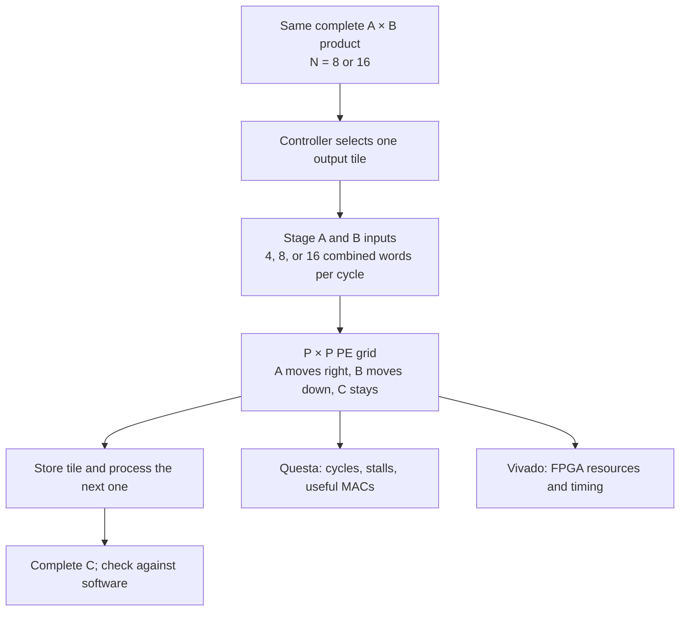

# Systolic Array Scaling: Project Overview

## The big picture

We are building a **small matrix-multiplication circuit** and asking an architecture question:

> If we add more arithmetic units, do we get a worthwhile speedup when the circuit can receive only a limited number of input values per cycle?

The answer may be “yes, but less than expected,” and it may depend on matrix size. We are measuring that tradeoff, not trying to prove in advance that the 8×8 design is best or that it fails.

A useful computer organization analogy is a CPU with more execution units. Those units help only if instructions and operands arrive fast enough to keep them busy. Our project studies the same balance in a specialized matrix accelerator.

## Zoom in: what the circuit does

Matrix multiplication computes each output as a series of **multiply-and-accumulate operations** (MACs):

$$
C[i,j]=\sum_{k=0}^{N-1}A[i,k]B[k,j].
$$

For example, if the first row of $A$ is $[1,2]$ and the first column of $B$ is $[5,7]$, then $C[0,0]=1(5)+2(7)=19$.

The circuit contains a square grid of **processing elements** (PEs). Each PE has a multiplier, an accumulator, and registers. In the chosen *output-stationary* design, each PE keeps one output value $C[i,j]$ while values from $A$ travel right and values from $B$ travel down:

| 2×2 grid | Output column 0 | Output column 1 |
|---|---|---|
| Output row 0 | PE holds $C[0,0]$ | PE holds $C[0,1]$ |
| Output row 1 | PE holds $C[1,0]$ | PE holds $C[1,1]$ |

The inputs must be staggered so the matching $A[i,k]$ and $B[k,j]$ reach a PE together. The PE multiplies them and adds the product to its output accumulator.



## Zoom out: what we build

We will implement **one VHDL design** that can generate three grid sizes: **2×2, 4×4, and 8×8**. It includes the PEs, input staging, valid/stall control, a controller for output tiles, and serial result readout. We will also build a testbench that compares every finished matrix against an independent software calculation.

Tiling is essential. A 2×2 grid cannot hold a whole 16×16 output, so it computes one 2×2 piece at a time. **Each piece still needs the full 16-element inner dimension**; then the controller saves it and starts the next piece.

| Complete output | 2×2 grid | 4×4 grid | 8×8 grid |
|---|---:|---:|---:|
| 8×8 matrix | 16 output tiles | 4 tiles | 1 tile |
| 16×16 matrix | 64 output tiles | 16 tiles | 4 tiles |

This ensures all three designs perform the **same complete multiplication**. A smaller grid does more sequential tile work; a larger grid uses more hardware.

The controller’s job is approximately this (conceptual pseudocode, not VHDL):

```cpp
for (int row = 0; row < N; row += P)
  for (int col = 0; col < N; col += P) {
    clear_PE_accumulators();

    for (int k = 0; k < N; ++k) {
      stage_matching_A_and_B_operands(row, col, k, budget_words);
      hold_grid_until_boundary_step_is_ready();
      advance_grid_one_step();
    }

    finish_in_flight_results();
    store_output_tile(row, col);
  }
```

## What we vary and measure

The experiment crosses **three grid sizes**, **two complete matrix sizes**, and **three modeled input budgets**: 4, 8, or 16 combined $A/B$ words per cycle. That is 18 core simulation configurations, plus correctness tests.

| Quantity | What it tells us |
|---|---|
| **Correctness** | Did every configuration produce the same $A\times B$, including signed values, tile boundaries, and stalls? |
| **Compute cycles and speedup** | How long from the first accepted input to the last completed tile, including stalls and tile changes? Readout cycles are reported separately. |
| **Useful MACs per cycle** | How much actual matrix work finishes per measured cycle? An $N\times N$ product contains $N^3$ useful MACs. |
| **PE utilization** | What fraction of the grid’s available MAC slots performed useful work? |
| **Stall cycles** | How much time did the input rule prevent the grid from advancing? |
| **DSPs, LUTs, flip-flops, BRAM, timing** | What FPGA resources does each design require, and can it meet the 10 ns clock target? |

Here is the input-supply issue in miniature. A $P\times P$ grid can need **up to $2P$** new boundary words for a full streaming step:

| Grid | PEs | Peak boundary demand | With an 8-word input budget |
|---|---:|---:|---|
| 2×2 | 4 | 4 words | Enough for a full step |
| 4×4 | 16 | 8 words | Enough for a full step |
| 8×8 | 64 | 16 words | A full step requires staging across two cycles |

That **does not mean** the 8×8 grid has no advantage. It has 64 PEs, so it may still finish first. The question is whether its gain justifies four times the PEs of the 4×4 grid. Short matrices also spend proportionally more time filling and draining the grid.

## Why this is computer architecture

| Familiar course concept | Its counterpart in this project |
|---|---|
| **Parallel execution / wider issue** | More PEs perform more MACs at once, provided they receive work. |
| **Pipeline fill, drain, and stalls** | Operands travel through the grid; input shortages hold valid work in place. |
| **Memory and data-supply bottlenecks** | The modeled input interface may feed fewer words than the grid can consume. |
| **Quantitative design tradeoffs** | We compare latency and utilization against additional FPGA resources and timing difficulty. |
| **Controlled cache experiments** | We hold the workload constant, change architectural parameters, and explain the measured response. |

The project guidelines explicitly include **systolic-array grid scaling versus input-bandwidth limits** as a suggested domain-acceleration topic. They prefer gem5 but allow a justified HDL prototype. VHDL is appropriate here because the question depends on the **actual placement of arithmetic units, cycle-by-cycle data movement, and correct stall behavior**. Questa tests those behaviors; Vivado estimates the implementation cost on the KV260 FPGA target. The proposal does **not** require buying or programming a board.

## What conclusion would count?

We are trying to identify **where additional PEs stop giving proportional benefit for these workloads and input budgets**, and what the extra hardware costs. A strong result might find that the 8×8 grid is fastest in cycles but less efficient per DSP under an eight-word budget. Another valid result might find that tile fill and drain matter more than the input limit for the 8×8 workload. Either result answers the question if the matrices are correct and comparisons are consistent.

The boundary is important: this experiment **does not measure actual KV260 DRAM bandwidth, CPU-versus-accelerator speedup, or power consumption**. The numbers in our draft presentation are illustrative examples; the VHDL simulations and Vivado reports will determine the findings.
