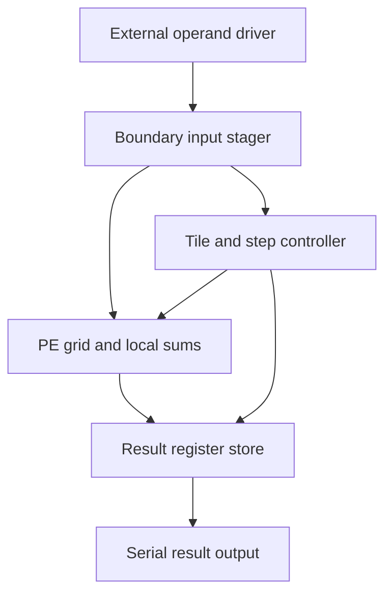
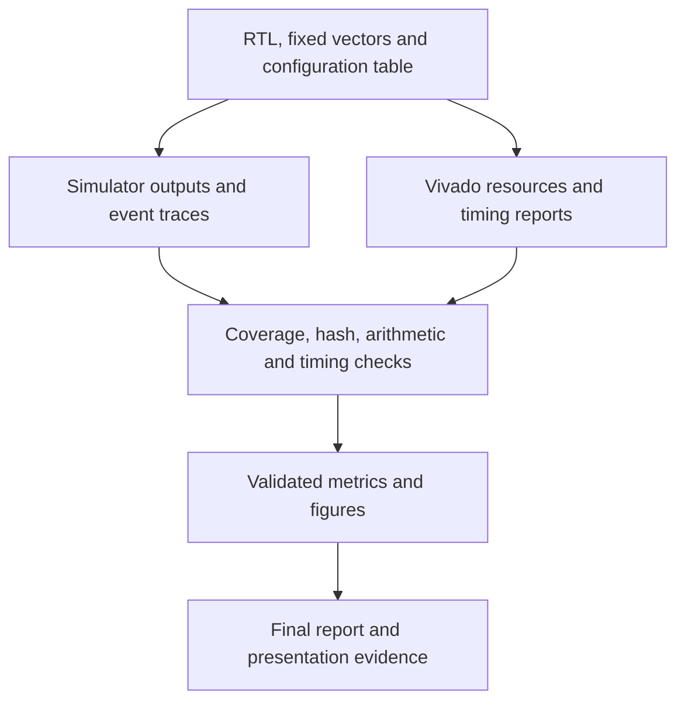

# Systolic Array Scaling Under Input Bandwidth Limits

**Technical and educational edition**

Ozlem Polat, Thomas Martin, Keith Kamer · University of Florida · EEL5764

How do arithmetic capacity, operand supply, finite workloads, and result delivery interact in a real RTL design?

This deck explains the implemented architecture and the original measured study. It is a longer companion to the illustrated presentation and [final report](../../deliverables/report/final-report.pdf).

---

## 1. The architectural question

A wider accelerator contains more arithmetic units. Its useful speedup also depends on how often those units receive matching operands and how long the surrounding control and output operations take.

We hold the PE design and dataflow constant, then vary the PE grid, complete matrix workload, and modeled boundary-input budget. Each candidate computes the same complete product for a given workload.

> [!question] Study question
> When does adding PEs deliver useful performance, and what prevents proportional scaling?

The reference is the **2×2 RTL array**. Every speedup in this study compares against that circuit with the same matrix order and input budget.

---

## 2. The experiment has three independent axes

| Symbol | Meaning | Values |
|---|---|---|
| $P$ | PE-grid dimension | 2, 4, 8 |
| $N$ | Complete square matrix order | 8, 16 |
| $B$ | Combined A/B input words accepted per physical clock | 4, 8, 16 |

$$
3\times2\times3=18\text{ simulation configurations}.
$$

Each configuration executes eight numerical cases, giving **144 passing cases per simulator sweep**. The FPGA comparison uses three routed implementations at $N=16$, one for each $P$. The runtime input budget does not require a separate implementation build.

**Matrix B** and the scalar **budget $B$** have different meanings. Context or indices distinguish them.

---

## 3. What one matrix product requires

$$
C[i,j]=\sum_{k=0}^{N-1}A[i,k]B[k,j].
$$

Each of the $N^2$ output elements requires $N$ useful multiply-and-accumulate operations:

$$
W_{\mathrm{MAC}}=N^3.
$$

| Matrix order | Output elements | Useful MACs |
|---|---:|---:|
| 8 | 64 | 512 |
| 16 | 256 | 4,096 |

One MAC performs a multiplication and an accumulation. Under the common two-operations convention, operation count is $2N^3$. Keep MAC/s and operations/s distinct when comparing rates.

---

## 4. A PE keeps a partial output

A processing element contains operand registers, valid/control state, a multiplier, and an accumulator. On an enabled edge with matching valid operands:

$$
\mathrm{acc}_{\mathrm{next}}=\mathrm{acc}+a\,b.
$$

The design uses **output-stationary** dataflow: the partial output stays in its PE while A operands move right and B operands move down.

This organization reuses each boundary operand across several PEs. A larger grid increases both parallel arithmetic capacity and the distance over which values propagate.

> [!note] Capacity versus work
> A $P\times P$ grid has $P^2$ MAC units. An available MAC unit contributes useful work only when its matching operands are valid.

---

## 5. Arithmetic width is part of correctness

All configurations use signed **16-bit operands** and **36-bit accumulators**. The width stays constant across the two workloads.

The largest positive product of two signed 16-bit values is:

$$
(-32768)(-32768)=2^{30}.
$$

Sixteen such products sum to $2^{34}$. A signed 35-bit result has maximum $2^{34}-1$, so it cannot represent that positive sum. A signed 36-bit accumulator can.

Checking only truncated output bits could hide arithmetic errors. The numerical reference compares the complete result width, including signed-extreme cases.

---

## 6. Skew makes matching operands meet

For output tile $(u,v)$, define global origins $(r_0,c_0)=(uP,vP)$. At local PE $(r,c)$:

$$
\begin{aligned}
A[r_0+r,k]&\text{ enters row }r\text{ at step }k+r,\\
B[k,c_0+c]&\text{ enters column }c\text{ at step }k+c.
\end{aligned}
$$

Each traverses the remaining links and reaches the PE on enabled step $k+r+c$. Therefore the paired operands use the same inner-dimension index $k$.

The word **enabled** matters: input stalls delay physical time without advancing this dataflow schedule.

---

## 7. Physical clocks and enabled steps

| Event | Physical clock advances | Grid advances | Useful MACs possible |
|---|---:|---:|---:|
| Boundary step ready | Yes | Yes | Yes, where operands are valid |
| Boundary step incomplete | Yes | No | No |
| Tile capture | Yes | No new arithmetic step | No |
| Serial readout | Yes | No | No |

A global hold preserves accumulator state, operand registers, and valid alignment. Advancing one part of the grid while another waits would break the operand pairing.

Compute latency counts elapsed physical clocks, including input stalls and capture. Counting only enabled steps would conceal the supply bottleneck being studied.

---

## 8. The modeled input interface

A full-demand boundary step can require $P$ A words and $P$ B words:

$$
w_{\max}=2P.
$$

| Grid | PEs | Peak new boundary words per step |
|---|---:|---:|
| 2×2 | 4 | 4 |
| 4×4 | 16 | 8 |
| 8×8 | 64 | 16 |

The stager accepts at most $B$ **combined** words per physical clock. It retains partial inputs and enables the grid when the complete boundary step is available. On the completing clock, bypass logic supplies unstored values directly.

This is a controlled RTL operand-supply rule. Actual KV260 DRAM bandwidth is outside the measured interface.

---

## 9. Full-demand staging is a bound

For a step requiring the maximum number of words:

$$
C_{\mathrm{step}}=\left\lceil\frac{2P}{B}\right\rceil.
$$

The first clock already belongs to the normal enabled-step schedule. Extra input-wait clocks for this step are:

$$
S_{\mathrm{step}}=\max(0,C_{\mathrm{step}}-1).
$$

For $P=8,B=8$, a full-demand step requires two physical clocks and adds one stall. Boundary demand is smaller during parts of the wavefront, so multiplying this peak bound by every step would overestimate latency.

---

## 10. A small grid still computes the full product

The controller partitions C into $P\times P$ output tiles:

$$
Q=\left(\frac NP\right)^2.
$$

| Workload | 2×2 grid | 4×4 grid | 8×8 grid |
|---|---:|---:|---:|
| $N=8$ | 16 tiles | 4 tiles | 1 tile |
| $N=16$ | 64 tiles | 16 tiles | 4 tiles |

Every output tile streams the **full inner dimension $N$**. The design does not split the inner dimension into smaller independently summed subproducts. After capturing one tile, it clears the PE accumulators for the next tile.

> [!important] Fair comparison
> Tile count changes with the grid. Required complete-product work remains $N^3$ MACs.

---

## 11. Data path and control boundaries



The driver belongs to the experimental environment. The grid, controller, result store, and readout belong to the RTL module. Separating these boundaries prevents an RTL throughput calculation from being mistaken for a complete host-to-board benchmark.

---

## 12. One output tile has structural overhead

The last PE receives its final useful pair after the inner-dimension stream and propagation across both grid dimensions:

$$
L=N+2(P-1)\text{ enabled steps per tile}.
$$

One additional physical clock captures all $P^2$ tile outputs and clears the grid.

With sufficient input supply:

$$
C_{\mathrm{compute},0}=Q\,[N+2(P-1)+1].
$$

Input wait adds physical clocks to this schedule. The capture term is present even when input stalls are zero.

---

## 13. Exact boundary word demand

At enabled boundary step $t$, row or column $i$ requests a new operand only when $0\leq t-i<N$. The total new-word demand is:

$$
w(t)=2\sum_{i=0}^{P-1}\mathbf{1}_{0\leq t-i<N}.
$$

Demand rises as more boundary lanes become active, may remain at $2P$, then falls. Later drain steps can require zero new words while values already inside the grid continue moving.

For a zero-demand step, the grid still advances once. The physical duration of a boundary step is therefore $\max(1,\lceil w(t)/B\rceil)$.

---

## 14. Exact input stalls and compute clocks

Summing only the additional clocks gives:

$$
S=Q\sum_{t=0}^{N+2P-3}
\max\left(0,\left\lceil\frac{w(t)}B\right\rceil-1\right).
$$

The complete compute count is:

$$
\boxed{C_{\mathrm{compute}}=Q[N+2(P-1)+1]+S.}
$$

The model follows the implemented global hold, complete-step bypass, and one-clock tile-capture behavior. Different overlap or capture policies would require a different model.

The analysis checks the measured counters against this equation for **every configuration**.

---

## 15. Worked example: $N=16,P=8$

There are four output tiles. Each tile has $16+14=30$ enabled steps and one capture clock.

$$
C_{\mathrm{compute},0}=4(30+1)=124.
$$

| Input budget | Total input stalls | Compute clocks |
|---|---:|---:|
| 4 | 180 | 304 |
| 8 | 60 | 184 |
| 16 | 0 | 124 |

At $B=8$, exactly fifteen enabled boundary steps per tile need a second physical clock. Four tiles therefore add sixty stalls. This is more precise than treating all thirty steps as full-demand steps.

---

## 16. Capacity-normalized cycle accounting

Useful MAC work, normalized by the number of PEs, is:

$$
C_{\mathrm{useful\ equivalent}}=\frac{N^3}{P^2}=QN.
$$

The exact accounting identity is:

$$
C_{\mathrm{compute}}=
\underbrace{QN}_{\text{useful-equivalent work}}+
\underbrace{Q(2P-2)}_{\text{fill/drain capacity cost}}+
\underbrace{Q}_{\text{capture}}+
\underbrace{S}_{\text{input waits}}.
$$

These terms add to measured clocks, but they are **not four sequential physical phases**. Useful MACs occur during the wavefront's fill and drain. The decomposition accounts for unused arithmetic capacity.

---

## 17. Why short products lose utilization

For the 8×8 grid at full supply:

| Term | $N=8$ | $N=16$ |
|---|---:|---:|
| Useful-equivalent clocks | 8 | 64 |
| Fill/drain capacity cost | 14 | 56 |
| Tile capture | 1 | 4 |
| Input stalls | 0 | 0 |
| Compute total | 23 | 124 |

The larger workload performs eight times the useful work, while its repeated wavefront and capture costs grow by four. It consequently uses the installed PEs more effectively.

Removing input stalls does not eliminate finite-workload overhead.

---

## 18. Throughput and utilization answer different questions

$$
T_{\mathrm{MAC/clock}}=\frac{N^3}{C_{\mathrm{compute}}},\qquad
U=\frac{N^3}{P^2C_{\mathrm{compute}}}.
$$

Throughput measures completed useful work per elapsed compute clock. Utilization measures the fraction of available PE-clock slots used for that work.

At $N=16,P=8,B=16$:

$$
T=\frac{4096}{124}=33.032\text{ MAC/clock},\qquad
U=\frac{4096}{64\cdot124}=51.613\%.
$$

A lower utilization percentage does not automatically mean lower throughput. A larger grid can execute more useful MACs while using a smaller fraction of its much larger capacity.

---

## 19. Compute speedup and scaling efficiency

For the same $N$ and $B$:

$$
S_{\mathrm{compute}}(P)=\frac{C_{\mathrm{compute}}(2)}{C_{\mathrm{compute}}(P)},\qquad
E(P)=\frac{S_{\mathrm{compute}}(P)}{P^2/4}.
$$

The 8×8 grid has sixteen times as many PEs as the 2×2 reference. At $N=16,B=16$:

$$
S_{\mathrm{compute}}=\frac{1216}{124}=9.806,
\qquad E=\frac{9.806}{16}=61.290\%.
$$

Efficiency compares observed speedup with PE-count growth. It differs from utilization: utilization divides useful MACs by the candidate grid's capacity, whereas efficiency also incorporates the reference implementation's measured overhead.

---

## 20. Serial readout changes the result

After the last tile capture, the RTL emits one full-width output word per clock with no backpressure:

$$
C_{\mathrm{total}}=C_{\mathrm{compute}}+N^2.
$$

| Wide-grid full-supply metric | $N=8$ | $N=16$ |
|---|---:|---:|
| Compute clocks | 23 | 124 |
| Serial readout clocks | 64 | 256 |
| Complete-product clocks | 87 | 380 |
| Compute speedup versus 2×2 | 7.652× | 9.806× |
| Complete-product speedup | 2.759× | 3.874× |

The speedup denominator and numerator must both include the same measurement boundary. Adding readout only to the candidate would create an invalid comparison.

---

## 21. The serial fraction limits further gains

At $N=16,P=8,B=16$, serial readout occupies:

$$
\frac{256}{380}=67.37\%
$$

of the complete-product clocks. Even an idealized zero-compute-latency candidate would still require 256 readout clocks under this interface.

Relative to the measured 2×2 total of 1,472 clocks, that interface gives a limiting speedup of $1472/256=5.75$. This is an analytical limit for the fixed readout rule, not another measured implementation.

> [!tip] Design implication
> Once output serialization dominates, adding arithmetic capacity has diminishing effect on complete-product latency. Changing that limit requires changing the output interface or overlap policy.

---

## 22. Operand reuse also changes input traffic

One tile requests $2PN$ boundary words. Across all $Q$ output tiles:

$$
W_{\mathrm{boundary}}=2PNQ=\frac{2N^3}{P}.
$$

For $N=16$, this derived boundary traffic is 4,096, 2,048, and 1,024 words on the three grids. A wider grid can demand more words in a particular step while requiring fewer boundary words over the complete product because each word reaches more PEs.

This helps explain why the wide grid remains faster even under a limited instantaneous input budget. The equation describes this RTL mapping's logical traffic. Cache behavior, host transfers, and physical DRAM transactions require additional system modeling.

---

## 23. Verification checks outputs and schedule

The original QuestaSim sweep and independent GHDL sweep each pass all 144 numerical cases. The Python reference computes exact full-width outputs.

Checks cover:

- Every output value and its serial readout order.
- Exactly $N^3$ useful MACs for the complete product.
- Physical compute, stall, capture, and readout counters.
- PE reset/clear priority, valid forwarding, global holds, and partial staging.
- Directed agreement between instrumented and synthesis-mode outputs.

Instrumentation equivalence here is a directed RTL regression. It should be described at that scope rather than as an exhaustive formal proof.

---

## 24. Evidence reaches the analysis through a validation gate



Source/vector hashes and tool metadata identify the recorded experiment. Validators reject incomplete configurations, duplicate rows, failed cases, modified evidence, and inconsistent counters before producing selected results.

Reproducibility includes both executable commands and evidence connecting an output to the source that produced it.

---

## 25. What the recorded activity views mean

| View | Quantity shown | Interpretation |
|---|---|---|
| PE topology | Useful MAC events at physical PE positions | Operand pairing and spatial activity |
| Work surface or completion map | Cumulative useful MACs divided by assigned full-product MACs | Arithmetic progress at a shared clock |
| Space–time activity | PE activity over physical clocks | Wavefront propagation, holds, and tile boundaries |
| First/last MAC map | First and last useful event at each PE in the first tile | Spatial delay of the wavefront |

Arithmetic reaching 100% does not mean all serial outputs have arrived. Capture and readout have their own measurement boundaries.

The trace figures use the fixed-seed performance case. Numerical correctness comes from the full eight-case sweep per configuration.

---

## 26. Reading a concrete trace

For $N=16,P=8,B=8$, the saved trace contains 440 physical clocks and 4,096 useful MAC events:

| Clock class | Count |
|---|---:|
| Enabled grid steps | 120 |
| Input stalls | 60 |
| Tile captures | 4 |
| Compute subtotal | 184 |
| Serial readout | 256 |
| Complete product | 440 |

Each PE contributes sixteen useful MACs before each tile capture. The complete product spans four output tiles. Zero MAC activity during a hold, capture, or readout is expected behavior.

Source: [`p8_n16_b8.csv`](../../results/verification/traces/p8_n16_b8.csv).

---

## 27. FPGA resources have different roles

| Resource | Role in this implementation |
|---|---|
| DSP | Dedicated arithmetic hardware used by the PE multipliers/MAC path |
| LUT | Configurable Boolean logic used for control, selection, addressing, and other mapped functions |
| Flip-flop | Registered state, including operands, results, and control |
| BRAM tile | Dedicated block-memory resource; the saved implementations use zero tiles |

Vivado elaborates the parameterized RTL, synthesizes it into target primitives, then places and routes the mapped design. The implementation utilization report counts the resulting resources.

LUT count is a tool-reported property of the complete implemented module. It is neither a handwritten performance-model value nor the number of arithmetic operations.

---

## 28. The original routed implementation evidence

All builds target `xck26-sfvc784-2LV-c`, use Vivado 2025.2.1, `INSTR=false`, and the same 10 ns internal clock constraint.

| Grid | LUTs | Flip-flops | DSPs | BRAM | Setup slack | Hold slack |
|---|---:|---:|---:|---:|---:|---:|
| 2×2 | 7,260 | 9,437 | 4 | 0 | +3.955 ns | +0.092 ns |
| 4×4 | 11,488 | 9,505 | 16 | 0 | +3.786 ns | +0.062 ns |
| 8×8 | 8,166 | 10,211 | 64 | 0 | +2.176 ns | +0.057 ns |

These are the original saved $N=16$ reports in [`results/vivado/`](../../results/vivado/). The report, all three PowerPoint editions, and this deck use that same hardware dataset. Later reruns do not silently replace it.

---

## 29. Interpreting the LUT counts carefully

The 4×4 implementation uses more LUTs than the 8×8 implementation in the saved reports. PE count alone does not determine the complete module's LUT count.

The module also contains result storage, capture selection, addressing, input staging, and control. Parameter changes can alter how synthesis and implementation map those structures.

The reports establish the measured counts. They do not isolate a particular netlist optimization as the cause of this non-monotonic ordering. A causal claim would require inspecting the mapped hierarchy/netlist or conducting a controlled implementation experiment.

The clear resource trend in this dataset is the DSP count: $4,16,64=P^2$. Performance-per-DSP calculations use those measured counts.

---

## 30. What a timing pass qualifies

A 10 ns period corresponds to a 100 MHz target clock. All three saved builds have positive internal setup and hold slack and no unconstrained internal endpoints.

The builds are **out of context**. External input and output delays are unspecified, so the timing statement covers the constrained internal paths.

It does not establish board I/O timing, measured operating frequency on a physical KV260, host-to-accelerator latency, or DRAM throughput. The report's rate calculation uses the timing-qualified target frequency, rather than treating slack as a direct measurement of a new maximum frequency.

Source: saved timing reports and the [clock constraint](../../constraints/).

---

## 31. Converting useful work into a rate

For a design that meets the 100 MHz target:

$$
R_{\mathrm{compute}}=\frac{N^3}{C_{\mathrm{compute}}}\,100\times10^6
\quad\mathrm{MAC/s}.
$$

At $N=16,P=8,B=16$:

$$
R_{\mathrm{compute}}=3.303\ \mathrm{GMAC/s},\qquad
R_{\mathrm{total}}=\frac{4096}{380}\,0.1=1.078\ \mathrm{GMAC/s}.
$$

Under the two-operations-per-MAC convention, these are 6.606 and 2.156 GOP/s. These are calculated useful-work rates at the qualified clock, with the stated RTL measurement boundaries.

---

## 32. Resource efficiency can favor a smaller grid

At $N=16,B=16$:

| Grid | Useful MAC/clock | DSPs | Useful MAC/clock/DSP |
|---|---:|---:|---:|
| 2×2 | 3.368 | 4 | 0.842 |
| 4×4 | 11.130 | 16 | 0.696 |
| 8×8 | 33.032 | 64 | 0.516 |

The 8×8 grid delivers the greatest absolute throughput. The 2×2 grid delivers the most useful throughput per DSP. A design choice therefore depends on whether the objective prioritizes latency or arithmetic-resource efficiency.

Throughput per DSP is not an energy-efficiency measurement. LUTs, registers, routing, clocking, and activity also affect physical cost and power.

---

## 33. Findings across the measured sweep

**Input supply limits scaling.** At $N=16,P=8$, raising the budget from four to sixteen words removes 180 stalls and reduces compute clocks from 304 to 124.

**Finite workloads limit utilization.** At full supply on 8×8, utilization is 34.8% for $N=8$ and 51.6% for $N=16$.

**Readout limits complete-product gains.** At $N=16,B=16$, compute speedup is 9.806× while complete-product speedup is 3.874×.

**The design objective matters.** The largest grid is fastest in every measured configuration. The smallest grid maximizes useful work per DSP in the hardware comparison.

---

## 34. Relation to prior work

TPU motivates large matrix arrays and the importance of feeding their arithmetic capacity. SCALE-Sim exposes dataflow, array geometry, and bandwidth for cycle-level exploration. Gemmini studies configurable accelerators within a fuller hardware/software stack. Scale-out Systolic Arrays examines array granularity and interconnected pods.

The structured-pruning study by Palacios et al. also examines systolic-array scaling, but it couples hardware with sparsity, transformer accuracy, and ASIC area/energy. Our dense integer RTL experiment isolates operand supply, finite wavefront costs, capture, and serial readout.

These works provide context. Their CPU-relative speedups, pruning rates, accuracy, ASIC areas, and energy figures are not substitutes for this project's measured quantities.

References and source links appear at the end of this deck and in the final report.

---

## 35. Reproduce analysis before rebuilding hardware

From the repository root after setup:

```bash
make analysis
```

This validates the selected saved evidence, then creates a uniquely named output directory containing metrics, plots, and an offline replay. It requires the Python analysis environment and the committed files, without a new FPGA implementation run.

For the complete open-source verification workflow:

```bash
make check
```

This runs vector checks, Python regressions, directed RTL tests, and a fresh simulation sweep. VS Code tasks provide the same analysis and validation entry points.

---

## 36. Measure a new complete experiment

With GHDL, Vivado, and the Python environment configured:

```bash
make study
```

The runner automatically allocates a new timestamped directory, checks inputs, executes all eighteen simulation configurations, and runs the six $(P,N)$ FPGA builds sequentially. It then validates and analyzes the new evidence.

The current report uses the selected original three-build hardware archive. A new six-build experiment stays in its own directory until deliberately reviewed and selected. Folder names identify executions; matrix order and grid dimension identify architectural configurations.

---

## 37. Publication and version control

```bash
make publish
```

Publication validates the selected study, regenerates the analysis and final report, and packages the curated native presentation. The report's tables and numerical macros come from the analysis outputs.

Three numbered PowerPoint editions preserve presentation development. The latest edition uses black text on light surfaces, the blue background, and consistent yellow emphasis. Its data charts, tables, and display equations are native editable objects.

This Markdown deck remains the editable technical explanation. The [presentation index](README.md) describes the editions, and Git history records report and documentation revisions.

---

## 38. Scope and discussion

The experiment establishes behavior for this dense RTL dataflow, fixed arithmetic width, complete-step input staging, sequential output tiles, and serial readout.

Further experiments could change output bandwidth, overlap capture/readout with computation, map result storage to BRAM, enlarge workloads, or change the dataflow. Each changes the architecture or measurement boundary and requires new comparable evidence.

Discussion prompts:

- Which overhead dominates a specified configuration, and how can the counters demonstrate it?
- Would increasing input supply still help after readout dominates total latency?
- Which resource or timing constraint matters for the intended deployment?
- What additional measurements would justify an energy or CPU-speedup claim?

---

## 39. Complete measured tables

The following two slides list every $(N,P,B)$ combination. Compute includes enabled steps, budget stalls, and capture. Total adds $N^2$ serial clocks. Gains use the matching 2×2 RTL reference.

Tables are generated from [`results/analysis/metrics.csv`](../../results/analysis/metrics.csv), whose numerical source is the saved simulation summary. They are presented here as Markdown text so every entry can be searched, inspected, and edited.

The [generated analysis](../../results/analysis/report.md) also contains timing-qualified throughput and hardware metrics. The next tables preserve both latency boundaries rather than reporting only the most favorable speedup.


---

## 40. Complete N=8 results

| P | B | Compute | Total | Stalls | MAC/clock | Utilization | Compute gain | Total gain |
|---|---:|---:|---:|---:|---:|---:|---:|---:|
| 2×2 | 4 | 176 | 240 | 0 | 2.909 | 72.7% | 1.000× | 1.000× |
| 2×2 | 8 | 176 | 240 | 0 | 2.909 | 72.7% | 1.000× | 1.000× |
| 2×2 | 16 | 176 | 240 | 0 | 2.909 | 72.7% | 1.000× | 1.000× |
| 4×4 | 4 | 88 | 152 | 28 | 5.818 | 36.4% | 2.000× | 1.579× |
| 4×4 | 8 | 60 | 124 | 0 | 8.533 | 53.3% | 2.933× | 1.935× |
| 4×4 | 16 | 60 | 124 | 0 | 8.533 | 53.3% | 2.933× | 1.935× |
| 8×8 | 4 | 44 | 108 | 21 | 11.636 | 18.2% | 4.000× | 2.222× |
| 8×8 | 8 | 30 | 94 | 7 | 17.067 | 26.7% | 5.867× | 2.553× |
| 8×8 | 16 | 23 | 87 | 0 | 22.261 | 34.8% | 7.652× | 2.759× |

Every row passes eight numerical cases. The serial readout contribution is 64 clocks in every row of this workload.


---

## 41. Complete N=16 results

| P | B | Compute | Total | Stalls | MAC/clock | Utilization | Compute gain | Total gain |
|---|---:|---:|---:|---:|---:|---:|---:|---:|
| 2×2 | 4 | 1216 | 1472 | 0 | 3.368 | 84.2% | 1.000× | 1.000× |
| 2×2 | 8 | 1216 | 1472 | 0 | 3.368 | 84.2% | 1.000× | 1.000× |
| 2×2 | 16 | 1216 | 1472 | 0 | 3.368 | 84.2% | 1.000× | 1.000× |
| 4×4 | 4 | 608 | 864 | 240 | 6.737 | 42.1% | 2.000× | 1.704× |
| 4×4 | 8 | 368 | 624 | 0 | 11.130 | 69.6% | 3.304× | 2.359× |
| 4×4 | 16 | 368 | 624 | 0 | 11.130 | 69.6% | 3.304× | 2.359× |
| 8×8 | 4 | 304 | 560 | 180 | 13.474 | 21.1% | 4.000× | 2.629× |
| 8×8 | 8 | 184 | 440 | 60 | 22.261 | 34.8% | 6.609× | 3.345× |
| 8×8 | 16 | 124 | 380 | 0 | 33.032 | 51.6% | 9.806× | 3.874× |

Every row passes eight numerical cases. The serial readout contribution is 256 clocks in every row of this workload.


---

## 42. References and project evidence

- Jouppi et al., *In-Datacenter Performance Analysis of a Tensor Processing Unit*, ISCA 2017. [Paper](https://arxiv.org/abs/1704.04760).
- Samajdar et al., *SCALE-Sim: Systolic CNN Accelerator Simulator*. [Paper](https://arxiv.org/abs/1811.02883).
- Genc et al., *Gemmini: An Agile Systolic Array Generator Enabling Systematic Evaluations of Deep-Learning Architectures*. [Paper](https://arxiv.org/abs/1911.09925).
- Yuzuguler et al., *Scale-out Systolic Arrays*. [Paper](https://arxiv.org/abs/2203.11540).
- Palacios et al., systolic arrays and structured-pruning co-design, GLSVLSI 2025. [Paper](https://arxiv.org/html/2411.10285v2).
- AMD, *Vivado Design Suite User Guide: Design Analysis and Closure Techniques*, UG906. [Documentation](https://docs.amd.com/r/2025.2-English/ug906-vivado-design-analysis).
- [GHDL documentation](https://ghdl.github.io/ghdl/).

Project sources: [architecture](../architecture.md), [experiments](../experiments.md), [simulation summary](../../results/summary_sim.csv), [FPGA reports](../../results/vivado/), [verification traces](../../results/verification/traces/), and [final report](../../deliverables/report/final-report.pdf).
